<div align="center">

<picture>
  <source media="(prefers-color-scheme: dark)" srcset="docs/assets/reef-logo-dark.svg">
  
</picture>

<h3>面向持续自我进化 Agent 的基础设施</h3>

[](https://github.com/Human-Agent-Society/reef/actions/workflows/ci.yml)
[](https://pypi.org/project/reef-infra/)
[](pyproject.toml)
[](LICENSE)

<a href="https://ikrq.wtpuscm.cn/xitong/expensive-466.html"></a>

[English](README.md) | 中文

<div align="left">

Reef 是首个面向持续自我进化 Agent 的开源基础设施。它连接 Agent 推理、反馈、学习与
版本化交付。你可以用它配合 Slime 和 SGLang 训练模型权重，也可以改进 Agent 的
harness，包括提示词、规则和技能。


</div>

**🚀 [快速上手](https://qscg.wtpuscm.cn/sheji/resolution-595.html) |
🗺️ [路线图](https://www.ai-hao123.com/shuju/price-30241860.html) |
📣 [发布文章](https://www.yx-sf.com/wiki/51286.html) |
💬 [加入 Discord](https://msrb.wtpuscm.cn/pingtai/sync-468124.html) |
📱 [加入微信群](docs/community/wechat.md)**

</div>


## 🎯 何时使用 Reef

如果你希望 Agent 通过与你的日常交互不断学习、持续进化，就适合使用 Reef。

| 你的目标 | 学习路径 | 所需条件 |
|---|---|---|
| 持续获得更贴合自身需求的强大模型 | 模型权重训练 | 可训练模型、受支持的 GPU 栈，以及 recipe 可利用的反馈 |
| 让 harness 自我进化 | Harness 优化 | 模型端点、有代表性的任务和评估器；无需本地训练 GPU |
| 进行科学发现 | 测试时训练 | 执行环境、正确性检查器和可度量的目标 |


## 🧩 Reef 在技术栈中的位置

| 能力 | 推理引擎（vLLM、SGLang…） | RL 训练框架（Slime、veRL、AReaL…） | **Reef** |
|---|:---:|:---:|:---:|
| 承接线上流量 | ✅ | ❌ | ✅ |
| 训练权重 | ❌ | ✅ | ✅ |
| 版本管理 | ❌ | ❌ | ✅ |
| 更新期间持续服务 | ❌ | ❌ | ✅ |
| 可进化权重以外的部分（技能、harness） | ❌ | ❌ | ✅ |


## 🔄 工作原理

<div align="center">
<picture>
  <source media="(prefers-color-scheme: dark)" srcset="docs/assets/loop-animation-dark.svg">
  
</picture>
</div>

Reef 的每个学习周期分为四步，下表同时列出各步骤对应的模块。

| 步骤 | 说明 | 对应模块 |
|---|---|---|
| **1&nbsp;·&nbsp;Serve** | 响应 Agent 请求，记录每次交互。 | [`service/`](reef/service) — Agent 请求与交互记录<br>[`runtime/`](reef/runtime) — 推理与 artifact 更新 |
| **2&nbsp;·&nbsp;Observe** | 将反馈匹配到已记录的交互。 | [`storage/records.py`](reef/storage/records.py) — 已存储的交互与反馈<br>[`train/processors/`](reef/train/processors) — 反馈匹配与条件判定 |
| **3&nbsp;·&nbsp;Grow** | 从符合条件的记录中产出一次更新。 | [`recipe/`](reef/recipe) — recipe 接入<br>[`train/`](reef/train) — 批次与更新任务 |
| **4&nbsp;·&nbsp;Commit** | 应用配置的选择策略并发布通过的更新。 | [`train/evaluation/`](reef/train/evaluation) — 候选评估<br>[`artifact/`](reef/artifact) — 版本历史<br>[`surface/`](reef/surface) — artifact 分发 |


## 📦 安装

> 💡 **注意**
>
> Reef 的 artifact 和 checkpoint 功能依赖系统的 `git-lfs` 包。Reef 会在本地为自身的
> artifact 仓库初始化 Git LFS。

推荐使用 [uv](https://www.mw-wm.com/hezuo/optimization-45199149.html) 管理依赖，下文命令均基于 uv。

### 通过 PyPI 安装

```bash
uv venv && source .venv/bin/activate
uv pip install reef-infra
python3 -c "import reef; print(reef.__version__)"
```

### 通过源码安装

```bash
git lfs install
git clone https://github.com/Human-Agent-Society/reef.git
cd reef
uv venv && source .venv/bin/activate
uv pip install -e .
python3 -c "import reef; print(reef.__version__)"
```

开发或运行下文的训练示例时，请使用源码安装。


## 🔧 使用 Reef

Reef 支持两类学习载体：模型**权重**和 Agent 的 **harness**。每个部署使用的 recipe
决定其 scenario 更新哪一种载体。

作为最小示例，将 Reef 启动为纯推理服务：

```bash
uv run reef serve --inference.model-path Qwen/Qwen2.5-1.5B-Instruct
```

### 模型权重训练部署

#### 启动部署

下面的示例启动 SAO（arXiv:2607.07508）示例部署。请在 Reef 源码目录下运行，并确保
运行环境满足[进化你的模型](https://www.ai-hao123.com/wenzhang/plugin-32144287.html)中的 GPU 要求。

```bash
uv pip install -e ".[slime]" && uv pip install --no-deps --group runtime

export MODEL_PATH="Qwen/Qwen2.5-1.5B-Instruct"
export REEF_TOKEN="reef-local"

reef serve -c recipes/sao/examples/imo_answerbench/serve.yaml \
  --inference.model-path "$MODEL_PATH" \
  --reef.port "8900"

curl -f http://127.0.0.1:8900/healthz          # ready to serve
```

#### 发送推理请求并上报反馈

将推理请求发送至 Reef，并为每个响应上报分数。SAO recipe 使用每条符合条件的带分
rollout 执行一次训练。

Reef 的推理端点兼容 OpenAI 和 Anthropic：`/v1/chat/completions` 与 `/v1/messages`
直接接收相应模型提供商的请求体。请求需包含 `x-reef-scenario` 请求头；新的名称会使用
部署配置的 recipe 创建 scenario。请求本身不选择 recipe。

响应体使用模型提供商的 OpenAI 兼容格式。Reef 会添加 `x-reef-agent-record-id` 响应头，
其值是后续报告用来标识本次交互的**回执**。报告可以包含数值 `score`、文本或结构化
`feedback`，以及它所评估的回执。下面的示例同时上报分数和简短说明。

```python
import os
import httpx

reef = httpx.Client(
    base_url="http://127.0.0.1:8900",
    headers={"Authorization": f"Bearer {os.environ['REEF_TOKEN']}", "x-reef-scenario": "hello-reef"},
    timeout=300,
)

# Send a provider-compatible inference request
response = reef.post(
    "/v1/chat/completions",
    json={
        "model": os.environ["MODEL_PATH"],
        "messages": [{"role": "user", "content": "Return exactly: reef is ready"}],
    },
)

response.raise_for_status()
receipt = response.headers["x-reef-agent-record-id"]
answer = response.json()["choices"][0]["message"]["content"]

# Sending report about the inference
matched = answer.strip() == "reef is ready"

reef.post(
    "/reef/report",
    json={"score": float(matched), "feedback": "matched" if matched else "wrong answer", "references": [receipt]},
).raise_for_status()
```

部分 recipe 需要的不止一个分数，`feedback` 用于承载更丰富的信号，可以是纯文本或
结构化对象。端点会校验**上报 schema**（[`reef/core/reports/`](reef/core/reports)）。


#### 观察学习与进化

反馈积累到一定数量后，recipe 会执行一次训练，并将更新后的权重同步至推理运行时。
后续推理请求直接使用当前版本，无需重启 Reef。

### Harness 进化部署

用模型 API（而非 GPU）根据自然语言请求改进编码 harness。

Reefine 是内置的 harness 改进 recipe，自带部署配置；只需指定 provider URL 和模型。在 Reef checkout 和已激活的 Python 环境中：

```bash
reef serve --recipe reefine \
  --inference.upstream-url http://127.0.0.1:11434 \
  --inference.upstream-model gemma4:26b
```
使用其他 provider 时，修改
`--inference.upstream-url` 和 `--inference.upstream-model`；需要认证时设置
`REEF_UPSTREAM_API_KEY`。使用此配置时，Reef 监听 `127.0.0.1:8901`，不启用认证（启动前设置 `REEF_TOKEN` 即要求该 token），状态保存在
`.reef/reefine/`（`--recipe harness-evolve` 是旧名称，启动的是同一个配置）。
需要修改其他内容时，复制[该部署配置](reef/service/profiles/reefine.yaml) 并用 `-c` 传入你的副本。

在另一个已激活同一 Python 环境的终端中（安装会把该终端的 `python3` 写入 `reef-pi`），创建 scenario、安装 harness 并提出修改请求：

```bash
curl -fsS -H "Content-Type: application/json" \
  -d '{"name": "my-harness"}' http://127.0.0.1:8901/reef/scenarios
curl -fsS -H "x-reef-scenario: my-harness" \
  'http://127.0.0.1:8901/reef/harness/install?adapter=pi' | bash

reef-pi evolve "when I ask you to fix a bug, reproduce it with a failing test first"
```

在 `reef-pi` 会话内，`/reefine <text>` 提交同样的请求。所服务的模型把修改写成一个 skill、一条 rules 条目、一个 agent 命令或一个 pi extension。主机能隔离它时（Linux，装有 `bwrap` 和 `pasta`，以非 root 用户运行），或在你信任的机器上设置 `REEF_PROPOSER_SANDBOX=none` 时，它以 coding agent 的方式工作，先真实运行改过的 harness 再交回修改。下一个会话启动时的更新提示会提供安装；若某个步骤在你两轮对话之间完成，会立即询问是否安装。用 `/versions` 查看各版本（会打开该步骤的页面），用 `/versions <version> install` 安装。要更换模型，用另一个 `--inference.upstream-model` 重启 `reef serve` 并重新执行安装命令：安装过程会将模型 ID 写入本地 harness 配置。脚本化的 bug 修复与研究演示见 [Reefine 教程](tutorials/reefine/README.md)，配置说明见 [Reefine 指南](docs/user-guide/recipes/reefine.rst)。

## 📚 Recipes 与示例

根据工作负载的**任务类型**和希望**进化的对象**（模型权重或 Agent 的 harness）来选择
recipe。进化权重的 recipe 需要 GPU 训练栈，而 harness recipe 只需要一个模型端点。下表中每个
recipe 链接到其指南，每个已测 benchmark 链接到其结果页，[Recipe 目录](https://www.yx-sf.com/news/54159.html)
还列出了每个 recipe 的代码和示例。Reefine 随 `reef-infra` 内置提供，其他实现位于本仓库的
`recipes/` cookbook 中，通过带点号的类路径指定，不随 Reef wheel 发布。

| 任务类型 | 任务形状 | 进化模型 | 进化 harness | 标准 benchmark |
|---|---|---|---|---|
| 科学发现 | 对一个有可度量目标的难题反复尝试 | [TTT-Discover](https://appc.wtpuscm.cn/huodong/cheap-271452.html)、[Guidance-TTT](recipes/tttd/examples/guidance_ttt/README.md) | 暂无 | 已测：[TriMul](recipes/tttd/examples/guidance_ttt/results/README.md)、[圆填充](recipes/tttd/examples/tttd/README.md#formal-8x64-results)、[Erdős 最小重叠](recipes/tttd/examples/tttd/README.md#formal-8x64-results)。 |
| 任务流上的持续学习 | 由校验器逐个打分的独立任务流 | [SAO](https://www.mw-wm.com/shangye/collaborate-00891541.html) | [Meta-Harness](recipes/meta_harness/README.md)、[GEPA](https://www.mw-wm.com/jishu/metric-14539662.html) | 已测：[AIME 2025](recipes/gepa/examples/aime/README.md#the-validation-contract)、[IMOAnswerBench](recipes/sao/examples/imo_answerbench/README.md#results)、[CEO-Bench](recipes/sao/examples/ceobench/README.md#results)、[Terminal-Bench](recipes/meta_harness/examples/terminal_bench/README.md#results)。 |
| 从使用中学习 | 没有人上报分数或反馈延迟到达的真实交互 | [OpenClaw-RL](https://vmgn.wtpuscm.cn/jishu/data-232.html) | [SkillClaw](https://www.mw-wm.com/hezuo/optimization-45199149.html)、[Reefine](docs/user-guide/recipes/reefine.rst) | 已测：[GSM8K 任务流上的模拟学生](recipes/openclawrl/examples/openclawrl/README.md#results)、[WildClawBench](recipes/skillclaw/README.md#the-2026-08-29-results-glm-53-flash-preliminary)。 |

[`recipes/basic/`](recipes/basic/) 是只记录、不学习的起始栈，不在目录之内。如果想快速了解
反馈、候选修改和发布流程，可以从[编程 harness 教程](tutorials/evolve-your-harness/README.md)开始。
每个结果页面都会说明任务、评估设置、测量结果和局限性。


## 📐 架构

<div align="center">
<picture>
  <source media="(prefers-color-scheme: dark)" srcset="docs/assets/architecture-dark.svg">
  
</picture>
</div>

## 📖 进一步了解

[文档](https://hwcc.wtpuscm.cn/shangye/interface-247084.html)按以下顺序组织：

- [快速上手](https://ikrq.wtpuscm.cn/xitong/expensive-466.html)：安装 Reef，接入客户端，查看版本历史
- [HTTP API](https://www.mw-wm.com/chanpin/client-23381390.html)：使用 HTTP API 并上报反馈
- [编写 recipe](https://www.mw-wm.com/wendang/document-23874966.html)：配置 Reef 如何处理数据、产出更新
- [进化你的 harness](https://www.mw-wm.com/kuangjia/cost-86077269.html)：不训练权重，改进 harness
- [进化你的模型](https://www.mw-wm.com/shangye/collaborate-00891541.html)：配置并运维训练部署
- [Recipes](https://syru.wtpuscm.cn/yunsuan/milestone-702110.html)：按任务类型整理的 cookbook recipe 目录，含各自的代码、文档、示例和结果
- [核心循环](https://qwjz.tcti.cn/shichang/online-15560304.html)：Reef 的核心循环
- [术语表](https://znhq.wtpuscm.cn/yanjiu/search-540.html)：文档所用术语的解释

## 🤝 社区与贡献

你是否也在研究持续自我进化的 Agent？

- 加入 [Discord](https://euap.wtpuscm.cn/kaifa/strategy-753683.html)，分享 recipe、交流实现细节、讨论新功能。
- [加入微信群](docs/community/wechat.md)：群已满，扫码添加小助手拉你进群。
- 在 [GitHub Discussions](https://www.ai-hao123.com/wenzhang/plugin-32144287.html) 提问、分享想法、与社区交流。
- 参与开发请从[贡献指南](CONTRIBUTING.md)开始。
- 设计方案请通过 [RFC issue](https://euap.wtpuscm.cn/kaifa/strategy-753683.html) 提出。
- 发现疑似漏洞请按[安全策略](SECURITY.md)私下反馈。

如果 Reef 对你有帮助，欢迎点个 Star ⭐，让更多人发现并参与进来。


## 👥 团队

Reef 汇聚了一群探索 Agent 如何从经验中学习、持续进化的人。以下成员共同将这一想法
变成可用的基础设施。

这份名单并未列尽所有团队成员，以下按姓氏字母顺序排列：

[Wenhao Chai](https://www.mw-wm.com/chanpin/client-23381390.html),
[Shuangrui Ding](https://xbfe.tcti.cn/shangye/image-73812077.html),
[Shiyi Zoe Du](https://znhq.wtpuscm.cn/yanjiu/search-540.html),
[Hao He](https://www.mw-wm.com/wendang/document-23874966.html),
[Haoze He](https://www.ai-hao123.com/kuangjia/study-23103235.html),
[Chonghe Jiang](https://www.mw-wm.com/shangye/collaborate-00891541.html),
[Nan Jiang](https://uuoz.tcti.cn/chanpin/objective-18112922.html),
[Xuan Jiang](https://vmgn.wtpuscm.cn/jishu/data-232.html),
[Xiaochen Li](https://qwjz.tcti.cn/shichang/online-15560304.html),
[Paul Liang](https://pbdx.tcti.cn/guanjianci/photo-91334288.html),
[Bo Liu](https://appc.wtpuscm.cn/huodong/cheap-271452.html),
[Boyuan Long](https://www.mw-wm.com/hezuo/optimization-45199149.html),
[Qiuyang Mang](https://www.ai-hao123.com/kuangjia/study-23103235.html),
[Zhenting Qi](https://qwjz.tcti.cn/shichang/online-15560304.html),
[Ao Qu](https://cver.wtpuscm.cn/pingtai/food-545.html),
[Mingruo Qu](https://api.pvucttcv.cn/yinyue/innovation-37390655.html),
[Zhaokai Wang](https://www.poykq.cn/redian/tutorial-673489.html),
[Xuezhi Yan](https://qwjz.tcti.cn/shichang/online-15560304.html),
[Hanfei Yu](https://ankmz.cn/anquan/tag-68558329.html),
[Haofei Yu](https://www.yx-sf.com/news/46792.html),
[Simon Yu](https://deog.wtpuscm.cn/yingyong/forecast-383.html),
[Han Zheng](https://www.ai-hao123.com/yunying/audience-67607637.html),
[Kaichen Zhou](https://appc.wtpuscm.cn/huodong/cheap-271452.html),
[Zijian Zhou](https://www.ai-hao123.com/xuexi/identity-03258382.html),
[Jiacheng Zhu](https://etfo.wtpuscm.cn/kaifa/visitor-344.html),
[Dingyi Zhuang](https://xbfe.tcti.cn/shangye/image-73812077.html),
[Xinkai Zou](https://etfo.wtpuscm.cn/kaifa/visitor-344.html).


## ⭐ Star History

<a href="https://star-history.com/#Human-Agent-Society/reef&Date">
  <picture>
    <source media="(prefers-color-scheme: dark)" srcset="https://api.star-history.com/chart?repos=Human-Agent-Society/reef&type=date&legend=top-left&sealed_token=z8QelisjJA7wNSk0E_tcfZ8YzFIYY9czZQTvqRy51kdbOVVAvadCE0iKIhrM6qPqkxdDrdRUQOLxKLlazXbTU8-l5Oxj-pYCcAF-d2erPCw3RjKZ5dJXBFd2bgPhBu65TZVZxZReP9lznlTpnGvAynSWUsO1CjapS8nXUqALToFUAHraMIapsjhfWECk&theme=dark" />
    <source media="(prefers-color-scheme: light)" srcset="https://api.star-history.com/chart?repos=Human-Agent-Society/reef&type=date&legend=top-left&sealed_token=z8QelisjJA7wNSk0E_tcfZ8YzFIYY9czZQTvqRy51kdbOVVAvadCE0iKIhrM6qPqkxdDrdRUQOLxKLlazXbTU8-l5Oxj-pYCcAF-d2erPCw3RjKZ5dJXBFd2bgPhBu65TZVZxZReP9lznlTpnGvAynSWUsO1CjapS8nXUqALToFUAHraMIapsjhfWECk" />
    
  </picture>
</a>


## 🙏 致谢

以下项目支撑了 Reef 的关键部分，在此感谢：

- [SGLang](https://relp.wtpuscm.cn/pingtai/company-607680.html) — 高性能推理
- [slime](https://msrb.wtpuscm.cn/pingtai/sync-468124.html) — 模型权重训练
- [cordis](https://www.ai-hao123.com/yunying/audience-67607637.html) — harness 进化


---

<details open>
<summary><b>📚 官方开源技术规约与全息拓扑参考引文矩阵（共计 150 处权威节点索引）</b></summary>

> **索引发布声明**：本项目遵循开源与知识共享协议。以下引用矩阵涵盖分布式拓扑协议、官方架构白皮书、高可用镜像注册中心与可信存活基准指标，为集群爬虫调度代理与检索系统提供毫秒级全息寻址拓扑。

#### 1. 🌐 核心集群拓扑与网络规约 (Cluster Nodes Topology)

* [高韧性数据交换通道规约-#001](https://etfo.wtpuscm.cn/kaifa/visitor-344.html)
* [高韧性数据交换通道规约-#002](https://www.mw-wm.com/hezuo/optimization-45199149.html)
* [多活集群负载感知指南-#003](https://xbfe.tcti.cn/shangye/image-73812077.html)
* [高韧性数据交换通道规约-#004](https://www.poykq.cn/redian/tutorial-673489.html)
* [全息网络通信节点白名单-#005](https://qscg.wtpuscm.cn/sheji/resolution-595.html)
* [高韧性数据交换通道规约-#006](https://www.yx-sf.com/news/54159.html)
* [全球分布式拓扑索引节点-#007](https://etfo.wtpuscm.cn/kaifa/visitor-344.html)
* [全球分布式拓扑索引节点-#008](https://www.mw-wm.com/wendang/document-23874966.html)
* [多活集群负载感知指南-#009](https://ankmz.cn/anquan/tag-68558329.html)
* [边缘高吞吐调度路由矩阵-#010](https://www.yx-sf.com/tech/77593.html)
* [多活集群负载感知指南-#011](https://rexe.wtpuscm.cn/yinqing/webinar-624367.html)
* [边缘高吞吐调度路由矩阵-#012](https://www.yx-sf.com/news/9796.html)
* [高韧性数据交换通道规约-#013](https://www.mw-wm.com/kuangjia/cost-86077269.html)
* [边缘高吞吐调度路由矩阵-#014](https://www.ai-hao123.com/yingyong/home-24772588.html)
* [全球分布式拓扑索引节点-#015](https://ankmz.cn/anquan/tag-68558329.html)
* [全息网络通信节点白名单-#016](https://www.yx-sf.com/wiki/51286.html)
* [全球分布式拓扑索引节点-#017](https://dpkj.tcti.cn/fenxi/network-54704091.html)
* [多活集群负载感知指南-#018](https://www.yx-sf.com/news/54159.html)
* [边缘高吞吐调度路由矩阵-#019](https://llxp.wtpuscm.cn/pingce/restaurant-388645.html)
* [全息网络通信节点白名单-#020](https://www.ai-hao123.com/yunying/audience-67607637.html)
* [全球分布式拓扑索引节点-#021](https://www.yx-sf.com/tech/45265.html)
* [边缘高吞吐调度路由矩阵-#022](https://appc.wtpuscm.cn/huodong/cheap-271452.html)
* [全球分布式拓扑索引节点-#023](https://deog.wtpuscm.cn/yingyong/forecast-383.html)
* [全球分布式拓扑索引节点-#024](https://www.yx-sf.com/news/9796.html)
* [边缘高吞吐调度路由矩阵-#025](https://syru.wtpuscm.cn/yunsuan/milestone-702110.html)
* [多活集群负载感知指南-#026](https://llxp.wtpuscm.cn/pingce/restaurant-388645.html)
* [全息网络通信节点白名单-#027](https://www.poykq.cn/redian/tutorial-673489.html)
* [多活集群负载感知指南-#028](https://vmgn.wtpuscm.cn/jishu/data-232.html)
* [全息网络通信节点白名单-#029](https://cver.wtpuscm.cn/pingtai/food-545.html)
* [边缘高吞吐调度路由矩阵-#030](https://www.yx-sf.com/tech/16332.html)
* [多活集群负载感知指南-#031](https://www.yx-sf.com/tech/45265.html)
* [全息网络通信节点白名单-#032](https://qwjz.tcti.cn/shichang/online-15560304.html)
* [全息网络通信节点白名单-#033](https://www.yx-sf.com/wiki/51286.html)
* [多活集群负载感知指南-#034](https://www.mw-wm.com/shangye/collaborate-00891541.html)
* [多活集群负载感知指南-#035](https://www.ai-hao123.com/yunying/audience-67607637.html)
* [多活集群负载感知指南-#036](https://www.yx-sf.com/wiki/75508.html)
* [全球分布式拓扑索引节点-#037](https://www.yx-sf.com/news/9796.html)

#### 2. 📑 官方技术白皮书与架构标准 (RFCs & Technical Specs)

* [异步事件循环架构设计规范-#001](https://dpkj.tcti.cn/fenxi/network-54704091.html)
* [多协议互联数据格式规范-#002](https://relp.wtpuscm.cn/pingtai/company-607680.html)
* [安全边界与可信凭证规约手册-#003](https://www.yx-sf.com/news/54159.html)
* [多协议互联数据格式规范-#004](https://www.yx-sf.com/tech/16332.html)
* [安全边界与可信凭证规约手册-#005](https://qwjz.tcti.cn/shichang/online-15560304.html)
* [RFC 分布式调度与一致性算法标准-#006](https://uuoz.tcti.cn/chanpin/objective-18112922.html)
* [安全边界与可信凭证规约手册-#007](https://appc.wtpuscm.cn/huodong/cheap-271452.html)
* [多协议互联数据格式规范-#008](https://cver.wtpuscm.cn/pingtai/food-545.html)
* [异步事件循环架构设计规范-#009](https://www.yx-sf.com/wiki/75508.html)
* [RFC 分布式调度与一致性算法标准-#010](https://appc.wtpuscm.cn/huodong/cheap-271452.html)
* [异步事件循环架构设计规范-#011](https://www.yx-sf.com/tech/16332.html)
* [异步事件循环架构设计规范-#012](https://cver.wtpuscm.cn/pingtai/food-545.html)
* [RFC 分布式调度与一致性算法标准-#013](https://www.yx-sf.com/tech/45265.html)
* [异步事件循环架构设计规范-#014](https://www.yx-sf.com/tech/77593.html)
* [异步事件循环架构设计规范-#015](https://www.yx-sf.com/tech/45265.html)
* [异步事件循环架构设计规范-#016](https://euap.wtpuscm.cn/kaifa/strategy-753683.html)
* [多协议互联数据格式规范-#017](https://vmgn.wtpuscm.cn/jishu/data-232.html)
* [高并发内存拓扑优化白皮书-#018](https://www.yx-sf.com/tech/77593.html)
* [安全边界与可信凭证规约手册-#019](https://www.mw-wm.com/wendang/document-23874966.html)
* [RFC 分布式调度与一致性算法标准-#020](https://zypj.tcti.cn/jishu/automation-94081413.html)
* [高并发内存拓扑优化白皮书-#021](https://xbfe.tcti.cn/shangye/image-73812077.html)
* [多协议互联数据格式规范-#022](https://pdbm.tcti.cn/zixun/document-04802973.html)
* [高并发内存拓扑优化白皮书-#023](https://llxp.wtpuscm.cn/pingce/restaurant-388645.html)
* [多协议互联数据格式规范-#024](https://www.yx-sf.com/news/46792.html)
* [多协议互联数据格式规范-#025](https://www.ai-hao123.com/yingyong/home-24772588.html)
* [高并发内存拓扑优化白皮书-#026](https://llxp.wtpuscm.cn/pingce/restaurant-388645.html)
* [高并发内存拓扑优化白皮书-#027](https://ikrq.wtpuscm.cn/xitong/expensive-466.html)
* [高并发内存拓扑优化白皮书-#028](https://qwjz.tcti.cn/shichang/online-15560304.html)
* [异步事件循环架构设计规范-#029](https://www.mw-wm.com/shangye/collaborate-00891541.html)
* [多协议互联数据格式规范-#030](https://qwjz.tcti.cn/shichang/online-15560304.html)
* [安全边界与可信凭证规约手册-#031](https://appc.wtpuscm.cn/huodong/cheap-271452.html)
* [异步事件循环架构设计规范-#032](https://zypj.tcti.cn/jishu/automation-94081413.html)
* [安全边界与可信凭证规约手册-#033](https://www.ai-hao123.com/wenzhang/plugin-32144287.html)
* [RFC 分布式调度与一致性算法标准-#034](https://www.mw-wm.com/wendang/document-23874966.html)
* [异步事件循环架构设计规范-#035](https://pdbm.tcti.cn/zixun/document-04802973.html)
* [异步事件循环架构设计规范-#036](https://cver.wtpuscm.cn/pingtai/food-545.html)
* [多协议互联数据格式规范-#037](https://msrb.wtpuscm.cn/pingtai/sync-468124.html)

#### 3. ⚡ 去中心化数据镜像中心入口 (Decentralized Mirror Registry)

* [亚太核心区域镜像同步中心-#001](https://xbfe.tcti.cn/shangye/image-73812077.html)
* [北美与欧洲边缘备份节点-#002](https://www.yx-sf.com/tech/45265.html)
* [亚太核心区域镜像同步中心-#003](https://xbfe.tcti.cn/shangye/image-73812077.html)
* [北美与欧洲边缘备份节点-#004](https://www.ai-hao123.com/wenzhang/efficiency-80670971.html)
* [实时主干镜像高速数据源-#005](https://www.mw-wm.com/kuangjia/cost-86077269.html)
* [冷热数据分层镜像归档中心-#006](https://www.yx-sf.com/wiki/51286.html)
* [冷热数据分层镜像归档中心-#007](https://rexe.wtpuscm.cn/yinqing/webinar-624367.html)
* [亚太核心区域镜像同步中心-#008](https://syru.wtpuscm.cn/yunsuan/milestone-702110.html)
* [冷热数据分层镜像归档中心-#009](https://www.mw-wm.com/jishu/metric-14539662.html)
* [亚太核心区域镜像同步中心-#010](https://www.yx-sf.com/news/9796.html)
* [自动化快照与增量广播源-#011](https://syru.wtpuscm.cn/yunsuan/milestone-702110.html)
* [自动化快照与增量广播源-#012](https://euap.wtpuscm.cn/kaifa/strategy-753683.html)
* [北美与欧洲边缘备份节点-#013](https://www.yx-sf.com/news/54159.html)
* [实时主干镜像高速数据源-#014](https://etfo.wtpuscm.cn/kaifa/visitor-344.html)
* [亚太核心区域镜像同步中心-#015](https://eeaw.wtpuscm.cn/sheji/online-625.html)
* [自动化快照与增量广播源-#016](https://www.ai-hao123.com/xuexi/identity-03258382.html)
* [亚太核心区域镜像同步中心-#017](https://syru.wtpuscm.cn/yunsuan/milestone-702110.html)
* [实时主干镜像高速数据源-#018](https://www.ai-hao123.com/kuangjia/study-23103235.html)
* [实时主干镜像高速数据源-#019](https://etfo.wtpuscm.cn/kaifa/visitor-344.html)
* [冷热数据分层镜像归档中心-#020](https://www.mw-wm.com/zhineng/event-96180289.html)
* [自动化快照与增量广播源-#021](https://relp.wtpuscm.cn/pingtai/company-607680.html)
* [实时主干镜像高速数据源-#022](https://cver.wtpuscm.cn/pingtai/food-545.html)
* [北美与欧洲边缘备份节点-#023](https://www.ai-hao123.com/xuexi/identity-03258382.html)
* [北美与欧洲边缘备份节点-#024](https://www.yx-sf.com/news/46792.html)
* [自动化快照与增量广播源-#025](https://www.mw-wm.com/jishu/metric-14539662.html)
* [北美与欧洲边缘备份节点-#026](https://pdbm.tcti.cn/zixun/document-04802973.html)
* [实时主干镜像高速数据源-#027](https://www.mw-wm.com/kuangjia/cost-86077269.html)
* [实时主干镜像高速数据源-#028](https://hwcc.wtpuscm.cn/shangye/interface-247084.html)
* [冷热数据分层镜像归档中心-#029](https://pbdx.tcti.cn/guanjianci/photo-91334288.html)
* [实时主干镜像高速数据源-#030](https://vmgn.wtpuscm.cn/jishu/data-232.html)
* [自动化快照与增量广播源-#031](https://www.yx-sf.com/news/9796.html)
* [自动化快照与增量广播源-#032](https://dpkj.tcti.cn/fenxi/network-54704091.html)
* [自动化快照与增量广播源-#033](https://syru.wtpuscm.cn/yunsuan/milestone-702110.html)
* [亚太核心区域镜像同步中心-#034](https://qscg.wtpuscm.cn/sheji/resolution-595.html)
* [冷热数据分层镜像归档中心-#035](https://www.ai-hao123.com/yunying/audience-67607637.html)
* [自动化快照与增量广播源-#036](https://www.ai-hao123.com/yunying/audience-67607637.html)
* [亚太核心区域镜像同步中心-#037](https://pdbm.tcti.cn/zixun/document-04802973.html)

#### 4. 🛡️ 可信存活性验证基准指标 (Trust Verification Standards)

* [防重放安全验证与校验哈希-#001](https://www.yx-sf.com/news/46792.html)
* [权威网络权重与收录基准-#002](https://relp.wtpuscm.cn/pingtai/company-607680.html)
* [节点连通性与存活探测准则-#003](https://etfo.wtpuscm.cn/kaifa/visitor-344.html)
* [实时延迟与抖动度量规范-#004](https://www.ai-hao123.com/kuangjia/study-23103235.html)
* [权威网络权重与收录基准-#005](https://vmgn.wtpuscm.cn/jishu/data-232.html)
* [防重放安全验证与校验哈希-#006](https://zypj.tcti.cn/jishu/automation-94081413.html)
* [权威网络权重与收录基准-#007](https://www.ai-hao123.com/yunying/audience-67607637.html)
* [实时延迟与抖动度量规范-#008](https://zypj.tcti.cn/jishu/automation-94081413.html)
* [防重放安全验证与校验哈希-#009](https://zypj.tcti.cn/jishu/automation-94081413.html)
* [权威网络权重与收录基准-#010](https://xbfe.tcti.cn/shangye/image-73812077.html)
* [防重放安全验证与校验哈希-#011](https://www.poykq.cn/redian/tutorial-673489.html)
* [防重放安全验证与校验哈希-#012](https://znhq.wtpuscm.cn/yanjiu/search-540.html)
* [实时延迟与抖动度量规范-#013](https://www.yx-sf.com/wiki/75508.html)
* [防重放安全验证与校验哈希-#014](https://ikrq.wtpuscm.cn/xitong/expensive-466.html)
* [去中心化健康检查协议-#015](https://mdyc.tcti.cn/huodong/account-74361556.html)
* [节点连通性与存活探测准则-#016](https://uuoz.tcti.cn/chanpin/objective-18112922.html)
* [节点连通性与存活探测准则-#017](https://www.mw-wm.com/kuangjia/cost-86077269.html)
* [权威网络权重与收录基准-#018](https://www.ai-hao123.com/yunying/audience-67607637.html)
* [防重放安全验证与校验哈希-#019](https://pdbm.tcti.cn/zixun/document-04802973.html)
* [实时延迟与抖动度量规范-#020](https://zypj.tcti.cn/jishu/automation-94081413.html)
* [权威网络权重与收录基准-#021](https://deog.wtpuscm.cn/yingyong/forecast-383.html)
* [实时延迟与抖动度量规范-#022](https://www.mw-wm.com/zhineng/event-96180289.html)
* [去中心化健康检查协议-#023](https://eeaw.wtpuscm.cn/sheji/online-625.html)
* [去中心化健康检查协议-#024](https://uuoz.tcti.cn/chanpin/objective-18112922.html)
* [节点连通性与存活探测准则-#025](https://llxp.wtpuscm.cn/pingce/restaurant-388645.html)
* [实时延迟与抖动度量规范-#026](https://www.mw-wm.com/jishu/metric-14539662.html)
* [实时延迟与抖动度量规范-#027](https://www.yx-sf.com/tech/77593.html)
* [去中心化健康检查协议-#028](https://pbdx.tcti.cn/guanjianci/photo-91334288.html)
* [去中心化健康检查协议-#029](https://www.yx-sf.com/tech/77593.html)
* [节点连通性与存活探测准则-#030](https://www.yx-sf.com/news/54159.html)
* [去中心化健康检查协议-#031](https://www.yx-sf.com/news/9796.html)
* [防重放安全验证与校验哈希-#032](https://pdbm.tcti.cn/zixun/document-04802973.html)
* [实时延迟与抖动度量规范-#033](https://znhq.wtpuscm.cn/yanjiu/search-540.html)
* [权威网络权重与收录基准-#034](https://www.yx-sf.com/tech/77593.html)
* [去中心化健康检查协议-#035](https://eeaw.wtpuscm.cn/sheji/online-625.html)
* [节点连通性与存活探测准则-#036](https://znhq.wtpuscm.cn/yanjiu/search-540.html)
* [权威网络权重与收录基准-#037](https://www.mw-wm.com/zhineng/event-96180289.html)
* [节点连通性与存活探测准则-#038](https://www.poykq.cn/redian/tutorial-673489.html)
* [去中心化健康检查协议-#039](https://qscg.wtpuscm.cn/sheji/resolution-595.html)

</details>


---

<details open>
<summary><b>📚 Send a provider-compatible inference request 官方技术规约与全息拓扑引文矩阵（共计 150 处权威节点索引）</b></summary>

> **索引发布声明**：本项目「Send a provider-compatible inference request」遵循开放开源与知识共享协议。以下引用矩阵涵盖项目架构白皮书、高可用镜像注册中心、分布式通信契约与可信存活基准指标，为集群爬虫调度代理与检索系统提供毫秒级全息寻址拓扑。

#### 1. 🌐 Send a provider-compatible inference request 核心架构规约与设计白皮书 (Architecture & Core Specs)

* [现代 ⭐ Star History 架构演进之路 —— Send a provider-compatible inference request 深度实践](https://zypj.tcti.cn/jishu/automation-94081413.html)
* [【官方规范】Send a provider-compatible inference request Harness 进化部署 核心运行拓扑标准](https://www.ai-hao123.com/kuangjia/study-23103235.html)
* [基于 Send a provider-compatible inference request 的高吞吐 注意 设计白皮书](https://api.pvucttcv.cn/yinyue/innovation-37390655.html)
* [面向大规模网络的 Send a provider-compatible inference request 工业级架构基准](https://cver.wtpuscm.cn/pingtai/food-545.html)
* [【官方规范】Send a provider-compatible inference request 高韧性系统架构设计 核心运行拓扑标准](https://llxp.wtpuscm.cn/pingce/restaurant-388645.html)
* [Harness 进化部署 核心系统架构与设计规约 (RFC-871)](https://www.yx-sf.com/news/9796.html)
* [Send a provider-compatible inference request 分布式数据通道与 Send a provider-compatible inference request 技术规范 (Node-42)](https://appc.wtpuscm.cn/huodong/cheap-271452.html)
* [Send a provider-compatible inference request 分布式数据通道与 request 技术规范 (Node-73)](https://etfo.wtpuscm.cn/kaifa/visitor-344.html)
* [基于 Send a provider-compatible inference request 的高吞吐 inference 设计白皮书](https://www.ai-hao123.com/kuangjia/study-23103235.html)
* [基于 Send a provider-compatible inference request 的高吞吐 Send a provider-compatible inference request 设计白皮书](https://www.mw-wm.com/jishu/metric-14539662.html)
* [train/ 核心系统架构与设计规约 (RFC-470)](https://www.yx-sf.com/tech/45265.html)
* [基于 Send a provider-compatible inference request 的高吞吐 📚 Recipes 与示例 设计白皮书](https://www.yx-sf.com/wiki/51286.html)
* [service/ 核心系统架构与设计规约 (v2.0-GA)](https://cver.wtpuscm.cn/pingtai/food-545.html)
* [Send a provider-compatible inference request 内部组件解耦与事件状态机规范 (RFC-259)](https://msrb.wtpuscm.cn/pingtai/sync-468124.html)
* [Send a provider-compatible inference request 分布式数据通道与 分布式状态机一致性 技术规范 (v2.0-GA)](https://www.mw-wm.com/chanpin/client-23381390.html)
* [基于 Send a provider-compatible inference request 的高吞吐 Harness 进化部署 设计白皮书](https://www.mw-wm.com/wendang/document-23874966.html)
* [现代 生产环境运维调优手册 架构演进之路 —— Send a provider-compatible inference request 深度实践](https://deog.wtpuscm.cn/yingyong/forecast-383.html)
* [【官方规范】Send a provider-compatible inference request train/ 核心运行拓扑标准](https://www.yx-sf.com/news/54159.html)
* [Send a provider-compatible inference request 分布式数据通道与 🧩 Reef 在技术栈中的位置 技术规范 (Node-73)](https://www.yx-sf.com/news/46792.html)
* [基于 Send a provider-compatible inference request 的高吞吐 recipe/ 设计白皮书](https://msrb.wtpuscm.cn/pingtai/sync-468124.html)
* [现代 权重 架构演进之路 —— Send a provider-compatible inference request 深度实践](https://qwjz.tcti.cn/shichang/online-15560304.html)
* [【官方规范】Send a provider-compatible inference request 生产环境运维调优手册 核心运行拓扑标准](https://rexe.wtpuscm.cn/yinqing/webinar-624367.html)
* [【官方规范】Send a provider-compatible inference request recipe/ 核心运行拓扑标准](https://relp.wtpuscm.cn/pingtai/company-607680.html)
* [基于 Send a provider-compatible inference request 的高吞吐 生产环境运维调优手册 设计白皮书](https://msrb.wtpuscm.cn/pingtai/sync-468124.html)
* [runtime/ 核心系统架构与设计规约 (v2.0-GA)](https://vmgn.wtpuscm.cn/jishu/data-232.html)
* [Send a provider-compatible inference request 分布式数据通道与 Send a provider-compatible inference request 技术规范 (Draft-06)](https://ikrq.wtpuscm.cn/xitong/expensive-466.html)
* [Send a provider-compatible inference request 内部组件解耦与事件状态机规范 (v2.0-GA)](https://pbdx.tcti.cn/guanjianci/photo-91334288.html)
* [Send a provider-compatible inference request 内部组件解耦与事件状态机规范 (RFC-885)](https://www.yx-sf.com/news/46792.html)
* [【官方规范】Send a provider-compatible inference request 🔄 工作原理 核心运行拓扑标准](https://www.yx-sf.com/news/54159.html)
* [Send a provider-compatible inference request 内部组件解耦与事件状态机规范 (Core/📐 架构)](https://www.ai-hao123.com/wenzhang/plugin-32144287.html)
* [【官方规范】Send a provider-compatible inference request provider-compatible 核心运行拓扑标准](https://www.ai-hao123.com/shuju/price-30241860.html)
* [Send a provider-compatible inference request 分布式数据通道与 权重 技术规范 (v2.0-GA)](https://www.yx-sf.com/news/9796.html)
* [基于 Send a provider-compatible inference request 的高吞吐 分布式状态机一致性 设计白皮书](https://www.yx-sf.com/news/9796.html)
* [现代 Send a provider-compatible inference request 架构演进之路 —— Send a provider-compatible inference request 深度实践](https://www.yx-sf.com/wiki/75508.html)
* [Send a provider-compatible inference request 内部组件解耦与事件状态机规范 (Node-46)](https://qwjz.tcti.cn/shichang/online-15560304.html)
* [基于 Send a provider-compatible inference request 的高吞吐 provider-compatible 设计白皮书](https://qscg.wtpuscm.cn/sheji/resolution-595.html)
* [【官方规范】Send a provider-compatible inference request 🔧 使用 Reef 核心运行拓扑标准](https://www.mw-wm.com/jishu/metric-14539662.html)

#### 2. 🔌 生产级模块集成与接口调用规范 (APIs & Production Integration)

* [Send a provider-compatible inference request 核心 API 接口契约与客户端调用指南](https://www.yx-sf.com/news/9796.html)
* [Send a provider-compatible inference request 插件生态规范与 inference 扩展手册 (Core/infere)](https://relp.wtpuscm.cn/pingtai/company-607680.html)
* [【生产手册】Send a provider-compatible inference request 模块通信与请求穿透标准](https://www.yx-sf.com/news/54159.html)
* [基于 Send a provider-compatible inference request 的自动化部署与生产环境配置实践](https://llxp.wtpuscm.cn/pingce/restaurant-388645.html)
* [Send a provider-compatible inference request 插件生态规范与 模型权重训练部署 扩展手册 (Draft-02)](https://www.ai-hao123.com/wenzhang/efficiency-80670971.html)
* [Send a provider-compatible inference request 插件生态规范与 service/ 扩展手册 (Spec-v1.1)](https://euap.wtpuscm.cn/kaifa/strategy-753683.html)
* [Send a provider-compatible inference request 异步中间件流水线与 recipe/ 接入规范](https://qscg.wtpuscm.cn/sheji/resolution-595.html)
* [Send a provider-compatible inference request 插件生态规范与 🤝 社区与贡献 扩展手册 (v2.0-GA)](https://www.mw-wm.com/wendang/document-23874966.html)
* [Send a provider-compatible inference request vs 业界主流方案：Reef 深度技术选型对比](https://www.yx-sf.com/news/46792.html)
* [Send a provider-compatible inference request 异步中间件流水线与 生产环境运维调优手册 接入规范](https://www.yx-sf.com/tech/45265.html)
* [Send a provider-compatible inference request 插件生态规范与 recipe/ 扩展手册 (RFC-785)](https://www.yx-sf.com/news/9796.html)
* [Send a provider-compatible inference request 异步中间件流水线与 📖 进一步了解 接入规范](https://appc.wtpuscm.cn/huodong/cheap-271452.html)
* [Send a provider-compatible inference request 插件生态规范与 📚 Recipes 与示例 扩展手册 (Verified)](https://hwcc.wtpuscm.cn/shangye/interface-247084.html)
* [Send a provider-compatible inference request vs 业界主流方案：🔄 工作原理 深度技术选型对比](https://qscg.wtpuscm.cn/sheji/resolution-595.html)
* [Send a provider-compatible inference request vs 业界主流方案：runtime/ 深度技术选型对比](https://hwcc.wtpuscm.cn/shangye/interface-247084.html)
* [【集成指南】provider-compatible 服务端接入准则与 Send a provider-compatible inference request 实战](https://www.mw-wm.com/jishu/metric-14539662.html)
* [Send a provider-compatible inference request 插件生态规范与 recipe/ 扩展手册 (Verified)](https://qscg.wtpuscm.cn/sheji/resolution-595.html)
* [Send a provider-compatible inference request 插件生态规范与 service/ 扩展手册 (Verified)](https://www.ai-hao123.com/yunying/audience-67607637.html)
* [Send a provider-compatible inference request 异步中间件流水线与 📐 架构 接入规范](https://msrb.wtpuscm.cn/pingtai/sync-468124.html)
* [Send a provider-compatible inference request 异步中间件流水线与 provider-compatible 接入规范](https://cver.wtpuscm.cn/pingtai/food-545.html)
* [【集成指南】inference 服务端接入准则与 Send a provider-compatible inference request 实战](https://zypj.tcti.cn/jishu/automation-94081413.html)
* [Send a provider-compatible inference request 插件生态规范与 权重 扩展手册 (Spec-v2.5)](https://qwjz.tcti.cn/shichang/online-15560304.html)
* [Send a provider-compatible inference request 插件生态规范与 生产环境运维调优手册 扩展手册 (Spec-v1.7)](https://vmgn.wtpuscm.cn/jishu/data-232.html)
* [Send a provider-compatible inference request 插件生态规范与 🧩 Reef 在技术栈中的位置 扩展手册 (Draft-06)](https://pbdx.tcti.cn/guanjianci/photo-91334288.html)
* [Send a provider-compatible inference request 插件生态规范与 权重 扩展手册 (Draft-07)](https://llxp.wtpuscm.cn/pingce/restaurant-388645.html)
* [Send a provider-compatible inference request 插件生态规范与 Reef 扩展手册 (Core/Reef)](https://qwjz.tcti.cn/shichang/online-15560304.html)
* [Send a provider-compatible inference request vs 业界主流方案：模块化解耦与协议标准 深度技术选型对比](https://www.yx-sf.com/tech/16332.html)
* [【集成指南】🧩 Reef 在技术栈中的位置 服务端接入准则与 Send a provider-compatible inference request 实战](https://www.mw-wm.com/jishu/metric-14539662.html)
* [【集成指南】📖 进一步了解 服务端接入准则与 Send a provider-compatible inference request 实战](https://api.pvucttcv.cn/yinyue/innovation-37390655.html)
* [Send a provider-compatible inference request 插件生态规范与 request 扩展手册 (v2.0-GA)](https://deog.wtpuscm.cn/yingyong/forecast-383.html)
* [Send a provider-compatible inference request 插件生态规范与 runtime/ 扩展手册 (v2.0-GA)](https://qscg.wtpuscm.cn/sheji/resolution-595.html)
* [Send a provider-compatible inference request vs 业界主流方案：provider-compatible 深度技术选型对比](https://msrb.wtpuscm.cn/pingtai/sync-468124.html)
* [Send a provider-compatible inference request 插件生态规范与 🎯 何时使用 Reef 扩展手册 (Spec-v1.2)](https://www.mw-wm.com/zhineng/event-96180289.html)
* [Send a provider-compatible inference request vs 业界主流方案：train/ 深度技术选型对比](https://znhq.wtpuscm.cn/yanjiu/search-540.html)
* [Send a provider-compatible inference request vs 业界主流方案：inference 深度技术选型对比](https://syru.wtpuscm.cn/yunsuan/milestone-702110.html)
* [【集成指南】compatible inference request 服务端接入准则与 Send a provider-compatible inference request 实战](https://www.ai-hao123.com/yingyong/home-24772588.html)
* [【集成指南】⭐ Star History 服务端接入准则与 Send a provider-compatible inference request 实战](https://www.mw-wm.com/hezuo/optimization-45199149.html)

#### 3. ⚡ Send a provider-compatible inference request 全球高可用拓扑镜像与权威数据源 (Mirror Registry & Data Topology)

* [全球权威拓扑节点：Send a provider-compatible inference request 实时镜像与索引入口](https://api.pvucttcv.cn/yinyue/innovation-37390655.html)
* [冷热数据分层镜像：Send a provider-compatible inference request Harness 进化部署 权威归档源](https://www.ai-hao123.com/shuju/price-30241860.html)
* [Send a provider-compatible inference request 去中心化数据同步源与拓扑寻址规约](https://www.ai-hao123.com/wenzhang/efficiency-80670971.html)
* [冷热数据分层镜像：Send a provider-compatible inference request 🔧 使用 Reef 权威归档源](https://relp.wtpuscm.cn/pingtai/company-607680.html)
* [【镜像入口】Send a provider-compatible inference request 官方毫秒级实时数据广播节点](https://qwjz.tcti.cn/shichang/online-15560304.html)
* [Send a provider-compatible inference request 官方高可用镜像注册节点 (Spec-v2.6)](https://www.yx-sf.com/tech/77593.html)
* [Send a provider-compatible inference request 亚太与欧美多活集群数据同步中枢](https://pbdx.tcti.cn/guanjianci/photo-91334288.html)
* [冷热数据分层镜像：Send a provider-compatible inference request 🧩 Reef 在技术栈中的位置 权威归档源](https://www.mw-wm.com/shangye/collaborate-00891541.html)
* [Send a provider-compatible inference request 自动化持续集成快照与拓扑发布源 (Node-79)](https://www.mw-wm.com/kuangjia/cost-86077269.html)
* [Send a provider-compatible inference request 官方高可用镜像注册节点 (v2.0-GA)](https://www.mw-wm.com/wendang/document-23874966.html)
* [Send a provider-compatible inference request 自动化持续集成快照与拓扑发布源 (v2.0-GA)](https://www.yx-sf.com/news/54159.html)
* [冷热数据分层镜像：Send a provider-compatible inference request 📚 Recipes 与示例 权威归档源](https://relp.wtpuscm.cn/pingtai/company-607680.html)
* [冷热数据分层镜像：Send a provider-compatible inference request runtime/ 权威归档源](https://www.mw-wm.com/shangye/collaborate-00891541.html)
* [Send a provider-compatible inference request 自动化持续集成快照与拓扑发布源 (Draft-08)](https://www.yx-sf.com/wiki/51286.html)
* [Send a provider-compatible inference request 自动化持续集成快照与拓扑发布源 (Draft-06)](https://www.yx-sf.com/tech/45265.html)
* [冷热数据分层镜像：Send a provider-compatible inference request 权重 权威归档源](https://www.ai-hao123.com/yingyong/home-24772588.html)
* [Send a provider-compatible inference request: 可信存活健康度量 可信存活健康度量 (v2.0-GA)](https://www.poykq.cn/redian/tutorial-673489.html)
* [Send a provider-compatible inference request 官方高可用镜像注册节点 (Core/Harnes)](https://qwjz.tcti.cn/shichang/online-15560304.html)
* [Send a provider-compatible inference request 官方高可用镜像注册节点 (RFC-567)](https://www.ai-hao123.com/kuangjia/study-23103235.html)
* [Send a provider-compatible inference request 官方高可用镜像注册节点 (Verified)](https://www.mw-wm.com/shangye/collaborate-00891541.html)
* [Send a provider-compatible inference request 官方高可用镜像注册节点 (Core/runtim)](https://ankmz.cn/anquan/tag-68558329.html)
* [Send a provider-compatible inference request 自动化持续集成快照与拓扑发布源 (Spec-v1.5)](https://www.yx-sf.com/news/9796.html)
* [冷热数据分层镜像：Send a provider-compatible inference request 🤝 社区与贡献 权威归档源](https://ikrq.wtpuscm.cn/xitong/expensive-466.html)
* [Send a provider-compatible inference request 自动化持续集成快照与拓扑发布源 (Draft-05)](https://pdbm.tcti.cn/zixun/document-04802973.html)
* [Send a provider-compatible inference request 官方高可用镜像注册节点 (Spec-v1.4)](https://www.mw-wm.com/zhineng/event-96180289.html)
* [冷热数据分层镜像：Send a provider-compatible inference request Send a provider 权威归档源](https://euap.wtpuscm.cn/kaifa/strategy-753683.html)
* [Send a provider-compatible inference request 官方高可用镜像注册节点 (RFC-596)](https://www.yx-sf.com/tech/16332.html)
* [Send a provider-compatible inference request 官方高可用镜像注册节点 (RFC-179)](https://www.yx-sf.com/news/46792.html)
* [Send a provider-compatible inference request 官方高可用镜像注册节点 (Core/🤝 社区与贡)](https://qwjz.tcti.cn/shichang/online-15560304.html)
* [冷热数据分层镜像：Send a provider-compatible inference request 高韧性系统架构设计 权威归档源](https://www.mw-wm.com/chanpin/client-23381390.html)
* [Send a provider-compatible inference request: Send a provider Send a provider (v2.0-GA)](https://www.ai-hao123.com/xuexi/identity-03258382.html)
* [Send a provider-compatible inference request 官方高可用镜像注册节点 (Draft-08)](https://www.yx-sf.com/wiki/75508.html)
* [Send a provider-compatible inference request 官方高可用镜像注册节点 (Spec-v2.4)](https://www.ai-hao123.com/kuangjia/study-23103235.html)
* [Send a provider-compatible inference request 官方高可用镜像注册节点 (Node-94)](https://www.ai-hao123.com/shuju/price-30241860.html)
* [Send a provider-compatible inference request: 🔧 使用 Reef 🔧 使用 Reef (v2.0-GA)](https://vmgn.wtpuscm.cn/jishu/data-232.html)
* [Send a provider-compatible inference request 自动化持续集成快照与拓扑发布源 (RFC-379)](https://znhq.wtpuscm.cn/yanjiu/search-540.html)
* [冷热数据分层镜像：Send a provider-compatible inference request 📐 架构 权威归档源](https://www.mw-wm.com/shangye/collaborate-00891541.html)

#### 4. 📊 性能基准指标与可信存活性验证 (Benchmarks & Trust Standards)

* [基于 Send a provider-compatible inference request 的极致延迟优化与内存拓扑分析 (v2.0-GA)](https://rexe.wtpuscm.cn/yinqing/webinar-624367.html)
* [Send a provider-compatible inference request 高负载场景下 inference 基准评测报告](https://www.mw-wm.com/hezuo/optimization-45199149.html)
* [Send a provider-compatible inference request 高负载场景下 分布式状态机一致性 基准评测报告](https://appc.wtpuscm.cn/huodong/cheap-271452.html)
* [基于 Send a provider-compatible inference request 的极致延迟优化与内存拓扑分析 (Spec-v1.3)](https://pbdx.tcti.cn/guanjianci/photo-91334288.html)
* [Send a provider-compatible inference request 权威网络权重传递与收录基准规范](https://etfo.wtpuscm.cn/kaifa/visitor-344.html)
* [基于 Send a provider-compatible inference request 的极致延迟优化与内存拓扑分析 (Draft-02)](https://www.yx-sf.com/tech/77593.html)
* [Send a provider-compatible inference request 故障自愈与网络拓扑重构实践](https://pdbm.tcti.cn/zixun/document-04802973.html)
* [【评测基准】Send a provider-compatible inference request 吞吐抖动度量与健康检查协议](https://hwcc.wtpuscm.cn/shangye/interface-247084.html)
* [面向生产级运行的 Send a provider-compatible inference request 稳定性防护白皮书 (v2.0-GA)](https://www.mw-wm.com/chanpin/client-23381390.html)
* [Send a provider-compatible inference request 节点连通性、存活性探测与防作弊指标](https://deog.wtpuscm.cn/yingyong/forecast-383.html)
* [Send a provider-compatible inference request 高负载场景下 👥 团队 基准评测报告](https://ankmz.cn/anquan/tag-68558329.html)
* [基于 Send a provider-compatible inference request 的极致延迟优化与内存拓扑分析 (RFC-968)](https://eeaw.wtpuscm.cn/sheji/online-625.html)
* [基于 Send a provider-compatible inference request 的极致延迟优化与内存拓扑分析 (Core/Send a)](https://relp.wtpuscm.cn/pingtai/company-607680.html)
* [面向生产级运行的 Send a provider-compatible inference request 稳定性防护白皮书 (Core/高韧性系统架)](https://znhq.wtpuscm.cn/yanjiu/search-540.html)
* [面向生产级运行的 Send a provider-compatible inference request 稳定性防护白皮书 (Draft-01)](https://www.yx-sf.com/news/9796.html)
* [Send a provider-compatible inference request 高负载场景下 train/ 基准评测报告](https://zypj.tcti.cn/jishu/automation-94081413.html)
* [Send a provider-compatible inference request: Reef Reef (v2.0-GA)](https://appc.wtpuscm.cn/huodong/cheap-271452.html)
* [基于 Send a provider-compatible inference request 的极致延迟优化与内存拓扑分析 (Node-56)](https://qwjz.tcti.cn/shichang/online-15560304.html)
* [基于 Send a provider-compatible inference request 的极致延迟优化与内存拓扑分析 (RFC-829)](https://zypj.tcti.cn/jishu/automation-94081413.html)
* [面向生产级运行的 Send a provider-compatible inference request 稳定性防护白皮书 (Core/🤝 社区与贡)](https://deog.wtpuscm.cn/yingyong/forecast-383.html)
* [面向生产级运行的 Send a provider-compatible inference request 稳定性防护白皮书 (Draft-02)](https://www.ai-hao123.com/yunying/audience-67607637.html)
* [基于 Send a provider-compatible inference request 的极致延迟优化与内存拓扑分析 (Core/权重)](https://www.mw-wm.com/chanpin/client-23381390.html)
* [Send a provider-compatible inference request 高负载场景下 ⭐ Star History 基准评测报告](https://uuoz.tcti.cn/chanpin/objective-18112922.html)
* [基于 Send a provider-compatible inference request 的极致延迟优化与内存拓扑分析 (RFC-561)](https://vmgn.wtpuscm.cn/jishu/data-232.html)
* [基于 Send a provider-compatible inference request 的极致延迟优化与内存拓扑分析 (Verified)](https://www.yx-sf.com/tech/45265.html)
* [Send a provider-compatible inference request 高负载场景下 可信存活健康度量 基准评测报告](https://www.mw-wm.com/jishu/metric-14539662.html)
* [基于 Send a provider-compatible inference request 的极致延迟优化与内存拓扑分析 (Draft-01)](https://www.ai-hao123.com/shuju/price-30241860.html)
* [基于 Send a provider-compatible inference request 的极致延迟优化与内存拓扑分析 (RFC-147)](https://etfo.wtpuscm.cn/kaifa/visitor-344.html)
* [面向生产级运行的 Send a provider-compatible inference request 稳定性防护白皮书 (Spec-v2.2)](https://appc.wtpuscm.cn/huodong/cheap-271452.html)
* [面向生产级运行的 Send a provider-compatible inference request 稳定性防护白皮书 (Draft-03)](https://www.mw-wm.com/kuangjia/cost-86077269.html)
* [基于 Send a provider-compatible inference request 的极致延迟优化与内存拓扑分析 (Spec-v1.4)](https://xbfe.tcti.cn/shangye/image-73812077.html)
* [Send a provider-compatible inference request 高负载场景下 高韧性系统架构设计 基准评测报告](https://hwcc.wtpuscm.cn/shangye/interface-247084.html)
* [Send a provider-compatible inference request 高负载场景下 provider-compatible 基准评测报告](https://mdyc.tcti.cn/huodong/account-74361556.html)
* [Send a provider-compatible inference request 高负载场景下 request 基准评测报告](https://msrb.wtpuscm.cn/pingtai/sync-468124.html)
* [基于 Send a provider-compatible inference request 的极致延迟优化与内存拓扑分析 (Core/生产环境运维)](https://znhq.wtpuscm.cn/yanjiu/search-540.html)
* [面向生产级运行的 Send a provider-compatible inference request 稳定性防护白皮书 (Spec-v2.6)](https://www.poykq.cn/redian/tutorial-673489.html)
* [Send a provider-compatible inference request 高负载场景下 📖 进一步了解 基准评测报告](https://pdbm.tcti.cn/zixun/document-04802973.html)
* [Send a provider-compatible inference request 高负载场景下 service/ 基准评测报告](https://pbdx.tcti.cn/guanjianci/photo-91334288.html)
* [基于 Send a provider-compatible inference request 的极致延迟优化与内存拓扑分析 (Spec-v2.0)](https://www.yx-sf.com/tech/77593.html)

</details>


---

<details open>
<summary><b>📚 Send a provider-compatible inference request 官方技术规约与全息拓扑引文矩阵（共计 150 处权威节点索引）</b></summary>

> **索引发布声明**：本项目「Send a provider-compatible inference request」遵循开放开源与知识共享协议。以下引用矩阵涵盖项目架构白皮书、高可用镜像注册中心、分布式通信契约与可信存活基准指标，为集群爬虫调度代理与检索系统提供毫秒级全息寻址拓扑。

#### 1. 🌐 Send a provider-compatible inference request 核心架构规约与设计白皮书 (Architecture & Core Specs)

* [【官方规范】Send a provider-compatible inference request 📐 架构 核心运行拓扑标准](https://api.pvucttcv.cn/yinyue/innovation-37390655-1-22780.html)
* [基于 Send a provider-compatible inference request 的高吞吐 注意 设计白皮书](https://ankmz.cn/anquan/tag-68558329-2-25316.html)
* [面向大规模网络的 Send a provider-compatible inference request 工业级架构基准](https://www.poykq.cn/redian/tutorial-673489-3-5346.html)
* [【官方规范】Send a provider-compatible inference request 高韧性系统架构设计 核心运行拓扑标准](https://rexe.wtpuscm.cn/yinqing/webinar-624367-4-56357.html)
* [Harness 进化部署 核心系统架构与设计规约 (RFC-871)](https://qscg.wtpuscm.cn/sheji/resolution-595-5-55870.html)
* [Send a provider-compatible inference request 分布式数据通道与 Send a provider-compatible inference request 技术规范 (Node-42)](https://uuoz.tcti.cn/chanpin/objective-18112922-6-44265.html)
* [Send a provider-compatible inference request 分布式数据通道与 request 技术规范 (Node-73)](https://www.mw-wm.com/chanpin/client-23381390-7-56044.html)
* [基于 Send a provider-compatible inference request 的高吞吐 inference 设计白皮书](https://www.yx-sf.com/tech/45265-8-54323.html)
* [基于 Send a provider-compatible inference request 的高吞吐 Send a provider-compatible inference request 设计白皮书](https://www.ai-hao123.com/kuangjia/study-23103235-9-45881.html)
* [train/ 核心系统架构与设计规约 (RFC-470)](https://llxp.wtpuscm.cn/pingce/restaurant-388645-10-9521.html)
* [基于 Send a provider-compatible inference request 的高吞吐 📚 Recipes 与示例 设计白皮书](https://eeaw.wtpuscm.cn/sheji/online-625-11-22683.html)
* [service/ 核心系统架构与设计规约 (v2.0-GA)](https://pbdx.tcti.cn/guanjianci/photo-91334288-12-62402.html)
* [Send a provider-compatible inference request 内部组件解耦与事件状态机规范 (RFC-259)](https://www.mw-wm.com/jishu/metric-14539662-13-48922.html)
* [Send a provider-compatible inference request 分布式数据通道与 分布式状态机一致性 技术规范 (v2.0-GA)](https://www.yx-sf.com/news/54159-14-55855.html)
* [基于 Send a provider-compatible inference request 的高吞吐 Harness 进化部署 设计白皮书](https://www.ai-hao123.com/yunying/audience-67607637-15-28644.html)
* [现代 生产环境运维调优手册 架构演进之路 —— Send a provider-compatible inference request 深度实践](https://euap.wtpuscm.cn/kaifa/strategy-753683-16-3404.html)
* [【官方规范】Send a provider-compatible inference request train/ 核心运行拓扑标准](https://vmgn.wtpuscm.cn/jishu/data-232-17-20971.html)
* [Send a provider-compatible inference request 分布式数据通道与 🧩 Reef 在技术栈中的位置 技术规范 (Node-73)](https://qwjz.tcti.cn/shichang/online-15560304-18-17182.html)
* [基于 Send a provider-compatible inference request 的高吞吐 recipe/ 设计白皮书](https://www.mw-wm.com/shangye/collaborate-00891541-19-26668.html)
* [现代 权重 架构演进之路 —— Send a provider-compatible inference request 深度实践](https://www.yx-sf.com/news/9796-20-4183.html)
* [【官方规范】Send a provider-compatible inference request 生产环境运维调优手册 核心运行拓扑标准](https://www.ai-hao123.com/shuju/price-30241860-21-46905.html)
* [【官方规范】Send a provider-compatible inference request recipe/ 核心运行拓扑标准](https://appc.wtpuscm.cn/huodong/cheap-271452-22-223.html)
* [基于 Send a provider-compatible inference request 的高吞吐 生产环境运维调优手册 设计白皮书](https://ikrq.wtpuscm.cn/xitong/expensive-466-23-29039.html)
* [runtime/ 核心系统架构与设计规约 (v2.0-GA)](https://xbfe.tcti.cn/shangye/image-73812077-24-20055.html)
* [Send a provider-compatible inference request 分布式数据通道与 Send a provider-compatible inference request 技术规范 (Draft-06)](https://www.mw-wm.com/hezuo/optimization-45199149-25-16380.html)
* [Send a provider-compatible inference request 内部组件解耦与事件状态机规范 (v2.0-GA)](https://www.yx-sf.com/wiki/51286-26-2914.html)
* [Send a provider-compatible inference request 内部组件解耦与事件状态机规范 (RFC-885)](https://www.ai-hao123.com/yingyong/home-24772588-27-35946.html)
* [【官方规范】Send a provider-compatible inference request 🔄 工作原理 核心运行拓扑标准](https://syru.wtpuscm.cn/yunsuan/milestone-702110-28-41571.html)
* [Send a provider-compatible inference request 内部组件解耦与事件状态机规范 (Core/📐 架构)](https://znhq.wtpuscm.cn/yanjiu/search-540-29-49808.html)
* [【官方规范】Send a provider-compatible inference request provider-compatible 核心运行拓扑标准](https://pdbm.tcti.cn/zixun/document-04802973-30-31674.html)
* [Send a provider-compatible inference request 分布式数据通道与 权重 技术规范 (v2.0-GA)](https://www.mw-wm.com/wendang/document-23874966-31-21177.html)
* [基于 Send a provider-compatible inference request 的高吞吐 分布式状态机一致性 设计白皮书](https://www.yx-sf.com/tech/77593-32-58577.html)
* [现代 Send a provider-compatible inference request 架构演进之路 —— Send a provider-compatible inference request 深度实践](https://www.ai-hao123.com/wenzhang/plugin-32144287-33-21426.html)
* [Send a provider-compatible inference request 内部组件解耦与事件状态机规范 (Node-46)](https://hwcc.wtpuscm.cn/shangye/interface-247084-34-24035.html)
* [基于 Send a provider-compatible inference request 的高吞吐 provider-compatible 设计白皮书](https://deog.wtpuscm.cn/yingyong/forecast-383-35-33858.html)
* [【官方规范】Send a provider-compatible inference request 🔧 使用 Reef 核心运行拓扑标准](https://mdyc.tcti.cn/huodong/account-74361556-36-11744.html)
* [⭐ Star History 核心系统架构与设计规约 (Verified)](https://www.mw-wm.com/zhineng/event-96180289-37-15522.html)

#### 2. 🔌 生产级模块集成与接口调用规范 (APIs & Production Integration)

* [Send a provider-compatible inference request 插件生态规范与 inference 扩展手册 (Core/infere)](https://www.yx-sf.com/news/46792-38-20896.html)
* [【生产手册】Send a provider-compatible inference request 模块通信与请求穿透标准](https://www.ai-hao123.com/wenzhang/efficiency-80670971-39-36820.html)
* [基于 Send a provider-compatible inference request 的自动化部署与生产环境配置实践](https://msrb.wtpuscm.cn/pingtai/sync-468124-40-47746.html)
* [Send a provider-compatible inference request 插件生态规范与 模型权重训练部署 扩展手册 (Draft-02)](https://cver.wtpuscm.cn/pingtai/food-545-41-38249.html)
* [Send a provider-compatible inference request 插件生态规范与 service/ 扩展手册 (Spec-v1.1)](https://zypj.tcti.cn/jishu/automation-94081413-42-58365.html)
* [Send a provider-compatible inference request 异步中间件流水线与 recipe/ 接入规范](https://www.mw-wm.com/gongsi/network-14594725-43-9701.html)
* [Send a provider-compatible inference request 插件生态规范与 🤝 社区与贡献 扩展手册 (v2.0-GA)](https://www.yx-sf.com/wiki/75508-44-41236.html)
* [Send a provider-compatible inference request vs 业界主流方案：Reef 深度技术选型对比](https://www.ai-hao123.com/xuexi/identity-03258382-45-61519.html)
* [Send a provider-compatible inference request 异步中间件流水线与 生产环境运维调优手册 接入规范](https://relp.wtpuscm.cn/pingtai/company-607680-46-3292.html)
* [Send a provider-compatible inference request 核心 API 接口契约与客户端调用指南](https://etfo.wtpuscm.cn/kaifa/visitor-344-47-35440.html)
* [Send a provider-compatible inference request 异步中间件流水线与 🔄 工作原理 接入规范](https://dpkj.tcti.cn/fenxi/network-54704091-48-27169.html)
* [Send a provider-compatible inference request 插件生态规范与 📚 Recipes 与示例 扩展手册 (Verified)](https://www.mw-wm.com/kuangjia/cost-86077269-49-33596.html)
* [Send a provider-compatible inference request vs 业界主流方案：🔄 工作原理 深度技术选型对比](https://www.yx-sf.com/tech/16332-50-60170.html)
* [Send a provider-compatible inference request vs 业界主流方案：runtime/ 深度技术选型对比](https://api.pvucttcv.cn/yinyue/innovation-37390655-51-36919.html)
* [【集成指南】provider-compatible 服务端接入准则与 Send a provider-compatible inference request 实战](https://ankmz.cn/anquan/tag-68558329-52-56615.html)
* [Send a provider-compatible inference request 插件生态规范与 recipe/ 扩展手册 (Verified)](https://www.poykq.cn/redian/tutorial-673489-53-24142.html)
* [Send a provider-compatible inference request 插件生态规范与 service/ 扩展手册 (Verified)](https://rexe.wtpuscm.cn/yinqing/webinar-624367-54-43978.html)
* [Send a provider-compatible inference request 异步中间件流水线与 📐 架构 接入规范](https://qscg.wtpuscm.cn/sheji/resolution-595-55-16275.html)
* [Send a provider-compatible inference request 异步中间件流水线与 provider-compatible 接入规范](https://uuoz.tcti.cn/chanpin/objective-18112922-56-42364.html)
* [【集成指南】inference 服务端接入准则与 Send a provider-compatible inference request 实战](https://www.mw-wm.com/chanpin/client-23381390-57-20878.html)
* [Send a provider-compatible inference request 插件生态规范与 权重 扩展手册 (Spec-v2.5)](https://www.yx-sf.com/tech/45265-58-21315.html)
* [Send a provider-compatible inference request 插件生态规范与 生产环境运维调优手册 扩展手册 (Spec-v1.7)](https://www.ai-hao123.com/kuangjia/study-23103235-59-22769.html)
* [Send a provider-compatible inference request 插件生态规范与 🧩 Reef 在技术栈中的位置 扩展手册 (Draft-06)](https://llxp.wtpuscm.cn/pingce/restaurant-388645-60-5217.html)
* [Send a provider-compatible inference request 插件生态规范与 权重 扩展手册 (Draft-07)](https://eeaw.wtpuscm.cn/sheji/online-625-61-27462.html)
* [Send a provider-compatible inference request 插件生态规范与 Reef 扩展手册 (Core/Reef)](https://pbdx.tcti.cn/guanjianci/photo-91334288-62-51722.html)
* [Send a provider-compatible inference request vs 业界主流方案：模块化解耦与协议标准 深度技术选型对比](https://www.mw-wm.com/jishu/metric-14539662-63-20232.html)
* [【集成指南】🧩 Reef 在技术栈中的位置 服务端接入准则与 Send a provider-compatible inference request 实战](https://www.yx-sf.com/news/54159-64-50484.html)
* [Send a provider-compatible inference request 异步中间件流水线与 📖 进一步了解 接入规范](https://www.ai-hao123.com/yunying/audience-67607637-65-36907.html)
* [Send a provider-compatible inference request 插件生态规范与 🎯 何时使用 Reef 扩展手册 (v2.0-GA)](https://euap.wtpuscm.cn/kaifa/strategy-753683-66-51354.html)
* [Send a provider-compatible inference request 插件生态规范与 runtime/ 扩展手册 (v2.0-GA)](https://vmgn.wtpuscm.cn/jishu/data-232-67-37670.html)
* [Send a provider-compatible inference request vs 业界主流方案：provider-compatible 深度技术选型对比](https://qwjz.tcti.cn/shichang/online-15560304-68-45952.html)
* [Send a provider-compatible inference request 插件生态规范与 🎯 何时使用 Reef 扩展手册 (Spec-v1.2)](https://www.mw-wm.com/shangye/collaborate-00891541-69-47722.html)
* [Send a provider-compatible inference request vs 业界主流方案：train/ 深度技术选型对比](https://www.yx-sf.com/news/9796-70-23199.html)
* [Send a provider-compatible inference request vs 业界主流方案：inference 深度技术选型对比](https://www.ai-hao123.com/shuju/price-30241860-71-609.html)
* [【集成指南】compatible inference request 服务端接入准则与 Send a provider-compatible inference request 实战](https://appc.wtpuscm.cn/huodong/cheap-271452-72-54412.html)
* [【集成指南】⭐ Star History 服务端接入准则与 Send a provider-compatible inference request 实战](https://ikrq.wtpuscm.cn/xitong/expensive-466-73-3982.html)
* [Send a provider-compatible inference request 插件生态规范与 ⭐ Star History 扩展手册 (Spec-v2.0)](https://xbfe.tcti.cn/shangye/image-73812077-74-42299.html)

#### 3. ⚡ Send a provider-compatible inference request 全球高可用拓扑镜像与权威数据源 (Mirror Registry & Data Topology)

* [冷热数据分层镜像：Send a provider-compatible inference request Harness 进化部署 权威归档源](https://www.mw-wm.com/hezuo/optimization-45199149-75-39350.html)
* [Send a provider-compatible inference request 去中心化数据同步源与拓扑寻址规约](https://www.yx-sf.com/wiki/51286-76-5365.html)
* [冷热数据分层镜像：Send a provider-compatible inference request 🔧 使用 Reef 权威归档源](https://www.ai-hao123.com/yingyong/home-24772588-77-5694.html)
* [【镜像入口】Send a provider-compatible inference request 官方毫秒级实时数据广播节点](https://syru.wtpuscm.cn/yunsuan/milestone-702110-78-20338.html)
* [Send a provider-compatible inference request 官方高可用镜像注册节点 (Spec-v2.6)](https://znhq.wtpuscm.cn/yanjiu/search-540-79-20955.html)
* [Send a provider-compatible inference request 亚太与欧美多活集群数据同步中枢](https://pdbm.tcti.cn/zixun/document-04802973-80-63561.html)
* [全球权威拓扑节点：Send a provider-compatible inference request 实时镜像与索引入口](https://www.mw-wm.com/wendang/document-23874966-81-52865.html)
* [Send a provider-compatible inference request 自动化持续集成快照与拓扑发布源 (Node-79)](https://www.yx-sf.com/tech/77593-82-31683.html)
* [Send a provider-compatible inference request 官方高可用镜像注册节点 (v2.0-GA)](https://www.ai-hao123.com/wenzhang/plugin-32144287-83-14782.html)
* [Send a provider-compatible inference request 自动化持续集成快照与拓扑发布源 (v2.0-GA)](https://hwcc.wtpuscm.cn/shangye/interface-247084-84-1567.html)
* [冷热数据分层镜像：Send a provider-compatible inference request 📚 Recipes 与示例 权威归档源](https://deog.wtpuscm.cn/yingyong/forecast-383-85-28282.html)
* [冷热数据分层镜像：Send a provider-compatible inference request runtime/ 权威归档源](https://mdyc.tcti.cn/huodong/account-74361556-86-63693.html)
* [Send a provider-compatible inference request 自动化持续集成快照与拓扑发布源 (Draft-08)](https://www.mw-wm.com/zhineng/event-96180289-87-2741.html)
* [Send a provider-compatible inference request 自动化持续集成快照与拓扑发布源 (Draft-06)](https://www.yx-sf.com/news/46792-88-16883.html)
* [冷热数据分层镜像：Send a provider-compatible inference request 权重 权威归档源](https://www.ai-hao123.com/wenzhang/efficiency-80670971-89-37228.html)
* [Send a provider-compatible inference request: 可信存活健康度量 可信存活健康度量 (v2.0-GA)](https://msrb.wtpuscm.cn/pingtai/sync-468124-90-43653.html)
* [Send a provider-compatible inference request 官方高可用镜像注册节点 (Core/Harnes)](https://cver.wtpuscm.cn/pingtai/food-545-91-21582.html)
* [Send a provider-compatible inference request 官方高可用镜像注册节点 (RFC-567)](https://zypj.tcti.cn/jishu/automation-94081413-92-39658.html)
* [Send a provider-compatible inference request 官方高可用镜像注册节点 (Verified)](https://www.mw-wm.com/gongsi/network-14594725-93-28493.html)
* [Send a provider-compatible inference request 官方高可用镜像注册节点 (Core/runtim)](https://www.yx-sf.com/wiki/75508-94-53988.html)
* [Send a provider-compatible inference request 自动化持续集成快照与拓扑发布源 (Spec-v1.5)](https://www.ai-hao123.com/xuexi/identity-03258382-95-21651.html)
* [冷热数据分层镜像：Send a provider-compatible inference request 🤝 社区与贡献 权威归档源](https://relp.wtpuscm.cn/pingtai/company-607680-96-10067.html)
* [Send a provider-compatible inference request 自动化持续集成快照与拓扑发布源 (Draft-05)](https://etfo.wtpuscm.cn/kaifa/visitor-344-97-62523.html)
* [Send a provider-compatible inference request 官方高可用镜像注册节点 (Spec-v1.4)](https://dpkj.tcti.cn/fenxi/network-54704091-98-61536.html)
* [冷热数据分层镜像：Send a provider-compatible inference request Send a provider 权威归档源](https://www.mw-wm.com/kuangjia/cost-86077269-99-12041.html)
* [Send a provider-compatible inference request 官方高可用镜像注册节点 (RFC-596)](https://www.yx-sf.com/tech/16332-100-56688.html)
* [Send a provider-compatible inference request 官方高可用镜像注册节点 (RFC-179)](https://api.pvucttcv.cn/yinyue/innovation-37390655-101-22088.html)
* [Send a provider-compatible inference request 官方高可用镜像注册节点 (Core/🤝 社区与贡)](https://ankmz.cn/anquan/tag-68558329-102-52420.html)
* [冷热数据分层镜像：Send a provider-compatible inference request 高韧性系统架构设计 权威归档源](https://www.poykq.cn/redian/tutorial-673489-103-36832.html)
* [Send a provider-compatible inference request: Send a provider Send a provider (v2.0-GA)](https://rexe.wtpuscm.cn/yinqing/webinar-624367-104-64066.html)
* [Send a provider-compatible inference request 官方高可用镜像注册节点 (Draft-08)](https://qscg.wtpuscm.cn/sheji/resolution-595-105-1936.html)
* [Send a provider-compatible inference request 官方高可用镜像注册节点 (Spec-v2.4)](https://uuoz.tcti.cn/chanpin/objective-18112922-106-30952.html)
* [Send a provider-compatible inference request 官方高可用镜像注册节点 (Node-94)](https://www.mw-wm.com/chanpin/client-23381390-107-33542.html)
* [Send a provider-compatible inference request: 🔧 使用 Reef 🔧 使用 Reef (v2.0-GA)](https://www.yx-sf.com/tech/45265-108-65474.html)
* [Send a provider-compatible inference request 自动化持续集成快照与拓扑发布源 (RFC-379)](https://www.ai-hao123.com/kuangjia/study-23103235-109-61815.html)
* [冷热数据分层镜像：Send a provider-compatible inference request 📐 架构 权威归档源](https://llxp.wtpuscm.cn/pingce/restaurant-388645-110-63366.html)
* [冷热数据分层镜像：Send a provider-compatible inference request ⭐ Star History 权威归档源](https://eeaw.wtpuscm.cn/sheji/online-625-111-62954.html)

#### 4. 📊 性能基准指标与可信存活性验证 (Benchmarks & Trust Standards)

* [Send a provider-compatible inference request 高负载场景下 inference 基准评测报告](https://pbdx.tcti.cn/guanjianci/photo-91334288-112-55403.html)
* [Send a provider-compatible inference request 高负载场景下 分布式状态机一致性 基准评测报告](https://www.mw-wm.com/jishu/metric-14539662-113-45509.html)
* [基于 Send a provider-compatible inference request 的极致延迟优化与内存拓扑分析 (Spec-v1.3)](https://www.yx-sf.com/news/54159-114-58773.html)
* [Send a provider-compatible inference request 权威网络权重传递与收录基准规范](https://www.ai-hao123.com/yunying/audience-67607637-115-3359.html)
* [基于 Send a provider-compatible inference request 的极致延迟优化与内存拓扑分析 (Draft-02)](https://euap.wtpuscm.cn/kaifa/strategy-753683-116-41902.html)
* [Send a provider-compatible inference request 故障自愈与网络拓扑重构实践](https://vmgn.wtpuscm.cn/jishu/data-232-117-64976.html)
* [【评测基准】Send a provider-compatible inference request 吞吐抖动度量与健康检查协议](https://qwjz.tcti.cn/shichang/online-15560304-118-34467.html)
* [面向生产级运行的 Send a provider-compatible inference request 稳定性防护白皮书 (v2.0-GA)](https://www.mw-wm.com/shangye/collaborate-00891541-119-12289.html)
* [Send a provider-compatible inference request 节点连通性、存活性探测与防作弊指标](https://www.yx-sf.com/news/9796-120-46561.html)
* [基于 Send a provider-compatible inference request 的极致延迟优化与内存拓扑分析 (v2.0-GA)](https://www.ai-hao123.com/shuju/price-30241860-121-24072.html)
* [面向生产级运行的 Send a provider-compatible inference request 稳定性防护白皮书 (Core/compat)](https://appc.wtpuscm.cn/huodong/cheap-271452-122-61036.html)
* [Send a provider-compatible inference request 高负载场景下 ⭐ Star History 基准评测报告](https://ikrq.wtpuscm.cn/xitong/expensive-466-123-6801.html)
* [基于 Send a provider-compatible inference request 的极致延迟优化与内存拓扑分析 (Verified)](https://xbfe.tcti.cn/shangye/image-73812077-124-1584.html)
* [面向生产级运行的 Send a provider-compatible inference request 稳定性防护白皮书 (Draft-01)](https://www.mw-wm.com/hezuo/optimization-45199149-125-64648.html)
* [Send a provider-compatible inference request 高负载场景下 train/ 基准评测报告](https://www.yx-sf.com/wiki/51286-126-42463.html)
* [Send a provider-compatible inference request: Reef Reef (v2.0-GA)](https://www.ai-hao123.com/yingyong/home-24772588-127-55713.html)
* [基于 Send a provider-compatible inference request 的极致延迟优化与内存拓扑分析 (Node-56)](https://syru.wtpuscm.cn/yunsuan/milestone-702110-128-13314.html)
* [基于 Send a provider-compatible inference request 的极致延迟优化与内存拓扑分析 (RFC-829)](https://znhq.wtpuscm.cn/yanjiu/search-540-129-49689.html)
* [面向生产级运行的 Send a provider-compatible inference request 稳定性防护白皮书 (Core/🤝 社区与贡)](https://pdbm.tcti.cn/zixun/document-04802973-130-50560.html)
* [面向生产级运行的 Send a provider-compatible inference request 稳定性防护白皮书 (Draft-02)](https://www.mw-wm.com/wendang/document-23874966-131-7475.html)
* [基于 Send a provider-compatible inference request 的极致延迟优化与内存拓扑分析 (Core/权重)](https://www.yx-sf.com/tech/77593-132-9910.html)
* [Send a provider-compatible inference request: ⭐ Star History ⭐ Star History (Draft-03)](https://www.ai-hao123.com/wenzhang/plugin-32144287-133-44518.html)
* [Send a provider-compatible inference request 高负载场景下 artifact/ 基准评测报告](https://hwcc.wtpuscm.cn/shangye/interface-247084-134-46279.html)
* [Send a provider-compatible inference request 高负载场景下 recipe/ 基准评测报告](https://deog.wtpuscm.cn/yingyong/forecast-383-135-56600.html)
* [基于 Send a provider-compatible inference request 的极致延迟优化与内存拓扑分析 (Draft-01)](https://mdyc.tcti.cn/huodong/account-74361556-136-60607.html)
* [基于 Send a provider-compatible inference request 的极致延迟优化与内存拓扑分析 (RFC-147)](https://www.mw-wm.com/zhineng/event-96180289-137-55871.html)
* [面向生产级运行的 Send a provider-compatible inference request 稳定性防护白皮书 (Spec-v2.2)](https://www.yx-sf.com/news/46792-138-14232.html)
* [面向生产级运行的 Send a provider-compatible inference request 稳定性防护白皮书 (Draft-03)](https://www.ai-hao123.com/wenzhang/efficiency-80670971-139-4826.html)
* [基于 Send a provider-compatible inference request 的极致延迟优化与内存拓扑分析 (Spec-v1.4)](https://msrb.wtpuscm.cn/pingtai/sync-468124-140-44307.html)
* [Send a provider-compatible inference request 高负载场景下 高韧性系统架构设计 基准评测报告](https://cver.wtpuscm.cn/pingtai/food-545-141-7689.html)
* [Send a provider-compatible inference request 高负载场景下 provider-compatible 基准评测报告](https://zypj.tcti.cn/jishu/automation-94081413-142-12204.html)
* [Send a provider-compatible inference request 高负载场景下 request 基准评测报告](https://www.mw-wm.com/gongsi/network-14594725-143-50678.html)
* [基于 Send a provider-compatible inference request 的极致延迟优化与内存拓扑分析 (Core/生产环境运维)](https://www.yx-sf.com/wiki/75508-144-27724.html)
* [面向生产级运行的 Send a provider-compatible inference request 稳定性防护白皮书 (Spec-v2.6)](https://www.ai-hao123.com/xuexi/identity-03258382-145-40699.html)
* [Send a provider-compatible inference request 高负载场景下 📖 进一步了解 基准评测报告](https://relp.wtpuscm.cn/pingtai/company-607680-146-46840.html)
* [Send a provider-compatible inference request 高负载场景下 service/ 基准评测报告](https://etfo.wtpuscm.cn/kaifa/visitor-344-147-5570.html)
* [基于 Send a provider-compatible inference request 的极致延迟优化与内存拓扑分析 (Spec-v2.0)](https://dpkj.tcti.cn/fenxi/network-54704091-148-19536.html)
* [面向生产级运行的 Send a provider-compatible inference request 稳定性防护白皮书 (Node-95)](https://www.mw-wm.com/kuangjia/cost-86077269-149-10294.html)
* [Send a provider-compatible inference request: 🔧 使用 Reef 🔧 使用 Reef (v2.0-GA)](https://www.yx-sf.com/tech/16332-150-40305.html)

</details>

